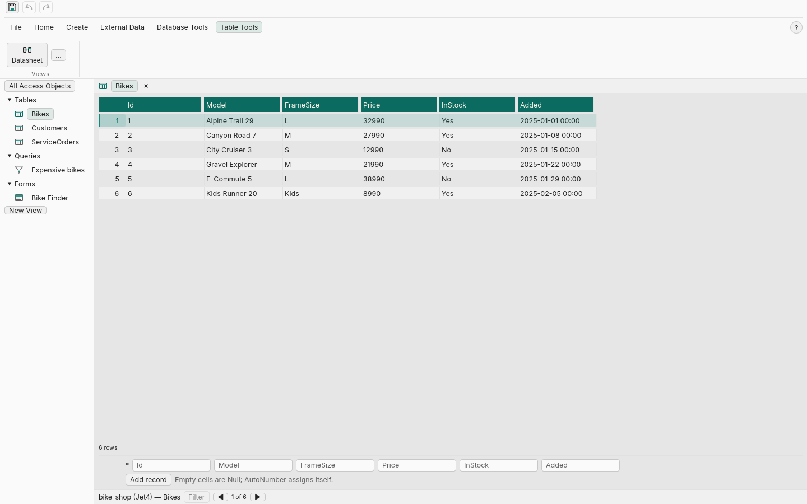

<div align="center">


**Databases and the classic Access workflow; an open-source, clean-room
reimplementation of the Microsoft Access experience, built in pure Rust.**

A fast, open-source database tool with a familiar workflow: the ribbon,
navigation pane, tabbed documents, datasheet and design views, the QBE query
builder and a form/report canvas. It reads Jet3/Jet4 `.mdb`, ACE `.accdb`,
SQLite databases and CSV directories, and writes Jet4/ACE and SQLite on
verified table/row paths (the
[compatibility matrix](#compatibility-matrix-verified-2026-11-12) states
exactly what is covered), runs natively on macOS, Windows and Linux, and is
designed to be operated by humans **and** AI agents through the same command
API.

[](https://www.rust-lang.org)
[](#)
[](#license-and-credits)
[](https://github.com/RealRauch/datacraft/actions/workflows/ci.yml)
[](https://github.com/RealRauch/datacraft/actions/workflows/release.yml)

**Why DataCraft** ·
[What works today](#what-works-today) ·
[Download and install](#download-and-install) ·
[Architecture](#architecture) ·
[Roadmap](#roadmap) ·
[Contributing](#contributing) ·
[Design](#design--branding) ·
[License and credits](#license-and-credits)

</div>



*The Bike Shop sample in the datasheet view — the same shell on Windows,
macOS and Linux.*

> [!NOTE]
> **DataCraft is pre-1.0; expect breaking changes.** The verified
> compatibility claims are in the [matrix below](#compatibility-matrix-verified-2026-11-12);
> current work lives in [PROGRESS.md](PROGRESS.md) and
> [BACKLOG.md](BACKLOG.md). DataCraft is an independent clean-room
> project, not affiliated with Microsoft.
## Download and install

Prebuilt archives for Windows, macOS and Linux are on the
[releases page](https://github.com/RealRauch/datacraft/releases/latest).
Each archive carries the desktop shell (`datacraft`), the CLI
(`datacraft-cli`), the MCP endpoint (`datacraft-mcp`), the sample
databases and the third-party notices. Unpack it and run the binary — no
Rust toolchain needed. The same page carries the `checksums-sha256.txt`.

From source (Rust 1.98+, pinned in `rust-toolchain.toml`; rustup installs
it automatically on build):

```bash
git clone https://github.com/RealRauch/datacraft
cd datacraft
cargo run -p datacraft-ui        # the desktop shell
cargo test --workspace           # unit, integration, proptest and golden-file tests
```

Headless clients of the same command bus:

```bash
echo '{"jsonrpc":"2.0","id":1,"method":"inspect"}' | cargo run -p datacraft-mcp
cargo run -p datacraft-cli -- open fixtures/testV2000.mdb --json
```

The libmdb oracle cross-check additionally runs in CI (ubuntu and macOS, with
`mdbtools` installed there); golden-file tests run everywhere.

## Why DataCraft

- **Familiar.** The Access workflow reimagined: ribbon, navigation pane,
  tabbed documents, datasheet and design views, the QBE grid, form and report
  canvas — in an original visual language of its own.
- **Your files.** Verified read paths for Jet3/Jet4 `.mdb`, ACE `.accdb`,
  SQLite and CSV, verified Jet4/ACE and SQLite writes, pure Rust. The
  [matrix](#compatibility-matrix-verified-2026-11-12) names every covered and
  unsupported path — no blanket "bit-for-bit" claim.
- **Clean-room.** Format knowledge comes from public specifications and our
  own black-box observation; MDB Tools is a test-time oracle, never linked
  into release builds.
- **Built for agents.** Every GUI action is exactly one command on a decoupled
  bus; the MCP/JSON-RPC endpoint and the CLI drive the same tool headlessly.
- **Fast.** egui on the GPU, virtualized painting of visible cells only, no
  per-frame allocations on the hot path — 60 FPS with million-row scrolling
  as the design target.
- **Verifiable.** Deterministic test IDs, serializable snapshots,
  property-based round-trips and golden files — tests assert on data, never
  on pixels.
## What works today

DataCraft reads Jet3/Jet4 `.mdb`, ACE `.accdb`, SQLite files and CSV
directories, and writes verified Jet4/ACE and SQLite table and row paths.
Around that engine sit the Access-style shell (ribbon, navigation pane,
datasheet, design view, QBE grid, form/report canvas), the expression and
query engines, native-query execution, macro/VBA extraction with static
analysis, SQL over every source, MCP/JSON-RPC and a CLI — all over one
command bus.

- **Formats:** Jet3/Jet4 read; Jet4 and ACE write (tables, rows, schema,
  indexes, relationships); SQLite read/write; CSV directories
  read/write; ACE complex values; RC4 passwords; Access lock-file
  co-existence.
- **Workbench:** datasheet with in-cell editing, sort/filter/freeze and
  undo/redo; table design with the property sheet; QBE builder; form and
  report designers with a runtime; relationship mapper; SQL window.
- **Programmability:** native saved queries (qualified dialect), macro
  inventory, VBA extraction, viewer and static analysis — no execution.
- **Automation:** the same commands through the GUI, `datacraft-cli` and
  the `datacraft-mcp` stdio endpoint; journaled writes and inspectable
  snapshots.
- **Data:** blank Jet4/SQLite databases, shipped templates and samples,
  CSV import, and the `datacraft-import` Access migration tool.

The full inventory — every capability with its phase provenance and known
limits — is in [docs/FEATURES.md](docs/FEATURES.md). The format claims are
in the [compatibility matrix](#compatibility-matrix-verified-2026-11-12);
the honest phase-by-phase picture is in
[docs/ROADMAP.md](docs/ROADMAP.md), and the format facts are catalogued in
[docs/FORMAT-JET.md](docs/FORMAT-JET.md).

## Compatibility matrix (verified 2026-11-12)

**Read** means decode through the `StoragePort`; **write** means the path
is exercised against a real file. Writes are verified as Access-readable
and usage-map-consistent — byte-identical output to Microsoft Access is
**not** claimed. The evidence behind every row — the test suites, oracle
lanes and CI runs — is in
[docs/COMPATIBILITY.md](docs/COMPATIBILITY.md).

| Format / path | Read | Write | Known limits |
| --- | --- | --- | --- |
| **Jet3 `.mdb`** | ✅ tables, TDEF chains, jump-table rows, overflow/LVAL, embedded OLE, RC4 password | ⬜ | fixture-tested only (no libmdb oracle); no write path; Jet3 VBA/macro definitions stay name-only |
| **Jet4 `.mdb`** | ✅ tables, catalog, rows, OLE/memo, relationships, native queries, index metadata, RC4 passwords | ✅ create/alter/drop table, insert/update/delete, indexes, relationships, journaled batches, AutoNumber; engine-accepted and user-verified in real Access (2026-11-07) | writer verified on Jet4 only; index leaves are maintained but never split (M15); engine-refused files recover through the create-path re-encode (49.4, M67); unsupported `MSysQueries` constructs surface as `native_queries_error` |
| **ACE `.accdb`** | ✅ 2007/2010/2016 tables, complex values, named macros, VBA project | ✅ create/alter/drop table, insert/update/delete, indexes, relationships on 2007/2010 | no external ACE oracle; the write reference is decode∘op∘decode against the pinned bytes; Office-encrypted files answer `Unsupported` |
| **Access co-existence** | ✅ a sibling lock file (`.ldb`/`.laccdb`) opens the session read-only and is named in the snapshot, the status bar and the Info page | ⬜ read-only while the lock file exists | DataCraft never creates or deletes lock files; detection is existence-only (M59) |
| **SQLite** | ✅ catalog, rows, foreign keys; native views read-only; index/trigger inventory; file facts and bounded `quick_check` | ✅ create/drop table, insert/update/delete, `CREATE [UNIQUE] INDEX`, foreign-key create/delete | schema alteration after create remains unsupported; `WITHOUT ROWID` rowid writes answer `Unsupported`; native view/trigger definitions are never created or executed |
| **CSV directories** | ✅ catalog, rows | ✅ create/drop table, insert/update/delete (one atomic rewrite per call) | column kinds inferred at open; values read as text; no schema alteration, relationships, native queries, macros or VBA; no engine-assigned AutoNumbers |
| **Form runtime (ADR-8)** | ✅ bound text/checkbox/combo editing with per-record commit, button actions, form-scoped filters | ✅ row writes through the driver (capability-gated) | no macro/VBA actions (ADR-2); design data lives in the sidecar; filters are session state, never written into Jet/ACE |
| **Design layer (ADR-1)** | sidecar forms, queries, reports and views; native saved queries read-only; native Access forms/reports listed read-only | ✅ sidecar save/load; sibling auto-load; ⬜ native form/report writes | native form/report definitions are neither decoded nor written; the sidecar is versioned and database-name checked |
| **Samples & templates** | ✅ every shipped sample opens with its expected tables/rows | ✅ `CreateDatabase` (Jet4 + SQLite), `CreateDatabaseFromTemplate` | Jet3/ACE files are never created; the Jet engine accepts the shipped and template-created databases (DAO oracle + real-Access walkthrough); field properties persist in the sidecar |
| **Programmability** | ✅ macro names with coarse arguments; VBA modules, source and static analysis | ⬜ read-only | no macro/VBA execution (ADR-2), no p-code; Jet3 macro/VBA definitions are not decoded |

**Sidecar vs native (ADR-1).** DataCraft's form, sidecar-query and report
designs live in `<database>.datacraft`; they are never written into Jet/ACE.
Native Access objects — saved queries, macros, VBA — are read-only. Opening a
database does not modify it.

## Architecture

| Layer | Crate | Job |
| --- | --- | --- |
| core | `datacraft-core` | domain model, command bus, state, snapshots, JSON-RPC transport |
| query | `datacraft-query` | QBE model, criteria, evaluation, native saved queries, shadow SQL engine |
| expr | `datacraft-expr` | Access-style expression engine |
| types | `datacraft-types` | value and schema vocabulary |
| jet | `datacraft-jet` | clean-room Jet3/Jet4 read, Jet4/ACE write |
| sqlite | `datacraft-sqlite` | SQLite backend (bundled rusqlite) |
| csv | `datacraft-csv` | CSV directory driver (ADR-7) |
| storage | `datacraft-storage` | driver composite and sample generator |
| ui | `datacraft-ui` | eframe/egui desktop shell |
| cli | `datacraft-cli` | headless command-bus CLI |
| mcp | `datacraft-mcp` | stdio JSON-RPC 2.0 endpoint |
| import | `datacraft-import` | Access form/report migration (third-party `jetdb`) |

Dependency direction is one-way and CI-enforced; the three client binaries
(`datacraft-ui`, `datacraft-cli`, `datacraft-mcp`) are the only composition
roots that name storage and the drivers. Every client speaks the same
`Command` vocabulary — a ribbon click and an MCP call produce identical
state transitions. The full blueprint, command API and ADRs are in
[docs/ARCHITECTURE.md](docs/ARCHITECTURE.md); the crates.io order and the
Semver/MSRV policy are in [docs/PUBLISHING.md](docs/PUBLISHING.md).
## Migrating from Microsoft Access

`datacraft-import` reads native Jet4/ACE `.mdb`/`.accdb` files **without
Microsoft Access** and merges the supported form/report designs into the
`.datacraft` sidecar next to the database:

```bash
cargo install datacraft-import
datacraft-import "MyApp.accdb"             # writes MyApp.datacraft
datacraft-import "MyApp.accdb" --strict    # exit 1 on any unsupported entry
```

Supported: label, text box, check box, combo box, command button and
subform with their rects, captions and bound fields. The database is opened
read-only and never modified; the sidecar is written atomically. Controls or
properties outside the subset are reported per object, never guessed —
combo row sources and controls whose geometry Access stored only as a
default are first-cut limitations. Access 97 (Jet3) form/report designs are
not supported; tables, queries and rows are opened by DataCraft itself.
The binding mapping contract is
[docs/M88-IMPORT.md](docs/M88-IMPORT.md).

## Roadmap

Delivered phases and open work live in [docs/ROADMAP.md](docs/ROADMAP.md);
the step-by-step history is in [PROGRESS.md](PROGRESS.md) and the
changelog. Compatibility is bought ring by ring — expression service →
query engine → macros → forms runtime. DataCraft implements **no VBA
interpreter or runtime**; VBA is extracted, displayed and statically
analyzed only (ADR-2). The verified claim set is the
[compatibility matrix](#compatibility-matrix-verified-2026-11-12).
## Contributing

The working agreement is [`AGENTS.md`](AGENTS.md); the practical entry —
test-first, the canonical verification set, the gate table and where the
detail lives — is [`CONTRIBUTING.md`](CONTRIBUTING.md). CI enforces
coverage ≥ 95 % lines, every `.rs` file below 500 lines, no banned
technical-debt markers, `rustfmt` and `clippy -D warnings`, rustdoc, the
crate-boundary guard and a three-OS test matrix; the oracle suite
cross-checks the Jet/ACE decoders against libmdb.

## Design & branding

The icon follows the office-symbol grammar of the sibling Crafting Apps: a
rounded tile in exactly three colours — ink `#0B0B0C`, paper `#EFE9DC` and
DataCraft teal `#0F8B7E` — with a flat database cylinder whose front is a
datasheet. Construction and palette:
[docs/brand/DATACRAFT-ICON.md](docs/brand/DATACRAFT-ICON.md). The UI uses a
neutral token system with a teal accent family (ADR-6), Inter and
JetBrains Mono (SIL OFL 1.1, attributed in [`assets/fonts/`](assets/fonts/)),
and original vector iconography; the chrome glyphs adapt the in-code set of
GridCraft/WordCraft (MIT OR Apache-2.0, attributed in
[`THIRD-PARTY-NOTICES.md`](THIRD-PARTY-NOTICES.md)). Appearance is
Light/Dark/System, persisted in `ui.json`.
## License and credits

DataCraft code is dual-licensed **MIT OR Apache-2.0** — canonical texts in
[`LICENSE-MIT`](LICENSE-MIT) and [`LICENSE-APACHE`](LICENSE-APACHE), the
Apache-side notice in [`NOTICE`](NOTICE). The shipped third-party components
(egui stack, csv, bundled SQLite, the two SIL-OFL fonts) and the committed
fixtures are attributed in
[`THIRD-PARTY-NOTICES.md`](THIRD-PARTY-NOTICES.md); fixture provenance is
pinned in [`fixtures/manifest`](fixtures/manifest). MDB Tools (`libmdb`,
LGPL-2.1) is a test-time oracle only and never linked into release builds.

Clean-room is binding: format knowledge comes from public specifications and
community documentation — never MDB Tools source code, never decompiled
Microsoft binaries (see `docs/ARCHITECTURE.md` §12).
